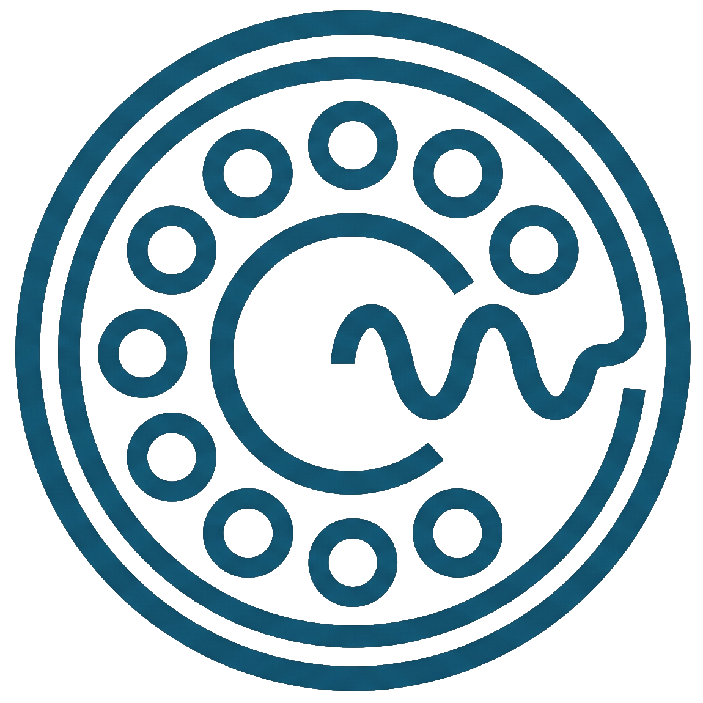
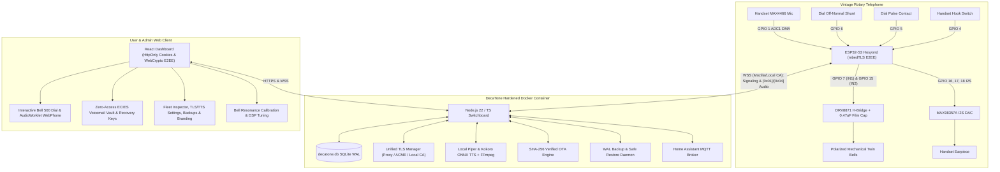

# DecaTone

<div align="center">
  

  <h3>End-to-End Encrypted Vintage Rotary Telephone VoIP Switch &amp; IoT System (v1.3.0)</h3>

  [](LICENSE)
  [](https://hub.docker.com/r/tylerhats/decatone)
  [](https://www.espressif.com/)
  [](https://nodejs.org/)
  [](https://react.dev/)
  [](https://github.com/TylerHats/DecaTone/wiki)
</div>

---

> [!CAUTION]
> **IMPORTANT E911 / EMERGENCY CALLING WARNING FOR PHYSICAL TELEPHONES**
>
> Vintage telephones converted with **DecaTone** operate exclusively over a private, self-hosted IP switchboard. They are **NOT** connected to the Public Switched Telephone Network (PSTN) and **CANNOT dial 911, 999, 112, or any public emergency dispatch service**. DecaTone telephones will not operate during electrical power failures, Wi-Fi outages, or server downtime.
>
> **Always affix a clear physical notice near converted rotary telephones informing household members and guests that the telephone cannot be used for emergency calls, and maintain an independent cellular or landline telephone for emergency access.**

---

## ☎️ Overview

**DecaTone** is an open-source, self-hosted private telephony switchboard and embedded hardware platform designed to revive vintage rotary telephones (Western Electric 500/2500/302, Automatic Electric AE40/AE50, British GPO 706/746, Kellogg, and European rotary phones). Powered by a **Hosyond ESP32-S3** (8MB Octal PSRAM / 16MB Flash), DecaTone combines authentic mechanical pulse dialing and bipolar H-bridge twin-gong bell ringing with **ECDSA-verified End-to-End Encrypted (E2EE) voice calls**, **Zero-Access encrypted voicemails**, **dual local offline neural TTS**, **4-slot party-line group calling**, **unified TLS (reverse proxy, ACME Let's Encrypt, and Private LAN CA)**, **SHA-256 verified OTA firmware updates**, and a retro-futuristic web switchboard.

---

## 🔐 End-to-End Encryption & Security Architecture

### 1. Real-Time Call E2EE (`ECDH P-256 + ECDSA + HKDF-SHA256 + AES-256-GCM`)
- **Zero Plaintext Relay**: Peer-to-peer and multi-party conference calls are encrypted end-to-end between ESP32-S3 hardware handsets (`mbedTLS`) and browser WebPhones (`WebCrypto` / `@noble/*`). The Node.js switchboard routes binary `[0x01]` and multi-party `[0x04][senderSlot]` ciphertext frames without ever possessing call media keys.
- **ECDSA Identity-Signed Ephemeral Keys & Safety Words**: Every session generates fresh ephemeral `secp256r1` (`P-256`) keypairs signed with the device's or user's persistent P-256 identity key (`decatone-e2ee-v1`), verified by peers against switchboard-pinned keys, and paired with **2-word ZRTP-style Safety Words** to confirm authenticity.
- **Multi-Party Key Rotation & 4-Slot Ring**: Supports automatic Key Leader handover (`e2ee_leader_changed`) with a 4-slot `keyId` ring buffer and out-of-band `[0x04][senderSlot]` per-participant mixing. Outbound mic frames use a per-session random 4-byte salt and monotonic 64-bit packet counter, suppressing audio until E2EE key agreement completes.

### 2. Zero-Access Encrypted Voicemail & Recovery Keys
- **Encrypted at Rest**: Recorded voicemails are immediately sealed to the recipient's `P-256` public key using ephemeral ECIES (`HKDF-SHA256` + `AES-256-GCM`) before touching disk (`*.enc`). The server never stores user plaintext private keys.
- **Chunked `[0x03]` Handset & Web Playback (`Dial 0`)**: Dialing `0` streams chunked binary `[0x03]` encrypted voicemail payloads to the ESP32-S3 (assembled in Octal PSRAM) or browser `AudioWorklet` Softphone for client-side decryption and playback confirmation (`voicemail_playback_done`).
- **Account Recovery Keys**: Users receive a Crockford Base32 **Account Recovery Key** during onboarding so voicemail access can be restored cleanly across password resets without key rotation loss.

### 3. Cookie Auth, Non-Extractable Browser Vaults & Hardware Trust
- **HttpOnly Cookie Sessions**: Web UI REST and WebSocket connections authenticate exclusively via `HttpOnly` cookies (zero `localStorage` tokens or `sessionStorage` private keys).
- **Non-Extractable WebCrypto IndexedDB Vault**: Over HTTPS/`localhost`, user identity keys live inside `decatone_vault_db` as non-extractable `CryptoKey` objects (with an explicit `@noble/*` RAM-only fallback banner on plain HTTP LAN setups).
- **Verified WSS, Pinning & Resilient NVS**: Each ESP32-S3 generates a permanent `P-256` NVS identity keypair (`dev_priv` / `dev_pub`), verifies TLS servers via Mozilla CA roots plus optional Local Root CA pinning, checks mandatory 64-char SHA-256 checksums on OTA firmware, and supports a **5-second `BOOT` (`GPIO 0`) factory reset** while preserving Wi-Fi across router outages.

---

## 🌟 Key Features

### 🔌 Antique Telephone Revival, H-Bridge Ringer & Core-1 DSP Audio
- **Continuous DMA Audio & 4-Slot Conference Mixer**: `audio_manager` captures handset audio via ESP-IDF v4.4 **32 kHz continuous ADC DMA** (`2:1` boxcar decimated to 16 kHz) and mixes up to 4 simultaneous `[0x04]` inbound conference streams alongside real-time handset sidetone, -18 dBFS RMS leveling, outbound mic AGC, vintage carbon-mic filters, and local synthesis of 12 Bell System progress tones.
- **IRAM-Safe Rotary Pulse Decoding**: Spinlock-protected IRAM ISRs (`esp_timer_get_time()` + `gpio_get_level()`) decode 1–10 mechanical pulses (`1`–`9`, `0`) with 320ms antique-governor support, bounce rejection (`>10` pulses ignored), 30ms stable hook debouncing, and accurate full-cycle break/make ratio & PPS telemetry.
- **3.3V Logic-Level DRV8871 H-Bridge AC Bell Driver**: Complementary outputs on **GPIO 7 (`IN1`)** and **GPIO 15 (`IN2`)** drive polarized twin-gong mechanical bells (`16.6Hz–50Hz`, `20Hz` default) with customizable cadences (`traditional`, `double_ring`, `short_short_long`, `continuous`, custom) and acoustic mic RMS resonance sweep calibration.
- **Intelligent Power Scaling**: Automatic CPU frequency scaling (`80MHz` on-hook idle → `240MHz` active telephony) and Wi-Fi modem sleep minimize standby heat.

### 🗣️ Dual Local Offline Neural TTS Engine (Piper & Optional Kokoro)
- **100% Self-Hosted Voice Prompts**: Runs on a native Debian slim (`node:22-slim` glibc) runtime with `ffmpeg` and `espeak-ng`, giving you a choice during initial setup or anytime in Admin Settings between **Piper Neural ONNX** (lightweight & fast default), optional **Kokoro-82M q8 Neural ONNX** (natural expressive prosody downloaded on demand with live progress UI), and **eSpeak-NG / Klatt Formant** — with zero cloud API keys or external voice data leakage.

### 🔐 Unified TLS Manager (`proxy`, `acme`, and `local_ca`)
- **Reverse Proxy Mode (`proxy`, default)**: Clean HTTP backend with Web-UI-configurable `trust_proxy` (`false` by default) for Nginx Proxy Manager, Caddy, or Traefik termination.
- **Automatic Let's Encrypt (`acme` mode)**: Built-in ACME HTTP-01 certificate issuance, scheduled renewal, and live HTTPS certificate hot-reload for bare-metal / direct internet hosts.
- **Private LAN Root CA (`local_ca` mode)**: Built-in local X.509 Root CA with downloadable `/api/tls/ca.crt`, configurable host/IP SANs, and automatic ESP32-S3 CA pinning.

### 👥 Multi-Phone Accounts, Composite Area Codes & Party-Line Auto-Join
- **Multiple Telephones per Account & Composite Area Codes**: Link multiple physical rotary phones to one extension with per-device labels and ring toggles (`ring_enabled`), with composite `(area_code, phone_number)` routing support.
- **Party-Line Auto-Join & Browser `AudioWorklet` Softphone**: Lifting any handset on your account during an active call automatically joins as an E2EE conference, alongside an `AudioWorklet`-powered WebPhone softphone (plus interactive click/keyboard/drag Bell 500 rotary dial and `WEB-MON-*` monitor-only tabs).

### 📻 Authentic Telephony Service Lines & In-Call Controls
- **`0`**: Interactive zero-access encrypted voicemail inbox (`1` replay, `3` next, `7` delete, `9` keep).
- **`00`**: Household intercom across all paired handsets on your account.
- **`0 + [Ext]`**: Leave a direct-to-voicemail memo without ringing the recipient.
- **`069`**: Automatic last number redial.
- **`072 + [Ext]` / `073`**: Enable or disable rotary call forwarding.
- **`078` / `079`**: Spoken Do Not Disturb (DND) status readout & toggle.
- **`111`**: Physical bell ringback test (hang up, wait 3s, bells ring back).
- **`119` / `099`**: Real-time `[0x00]` acoustic echo loopback test.
- **`411`**: Speaking clock with classic time pips (configured timezone).
- **`567` / `300`**: Bell 103 / V.34 modem handshake simulator.
- **`611`**: Spoken hardware & line diagnostics (Wi-Fi RSSI, firmware version, PPS/break ratio, bell Hz, heap/PSRAM).
- **`711`**: Automated local weather hotline (Open-Meteo + configured location).
- **`900`–`909`**: Configurable Home Assistant MQTT rotary automation triggers.
- **In-Call Rotary Actions**: Dial `2` for hardware mic mute/unmute, `3 + [Ext]` to invite another party into E2EE conference, `8` to park/unpark with comfort chime, or tap the cradle (`80ms–500ms`) for Hook-Flash / Call Waiting swap.

---

## 🏛️ System Architecture



---

## 🔌 Hardware Pinout (Hosyond ESP32-S3)

| Pin | Function | Peripheral / Connection |
| :--- | :--- | :--- |
| **GPIO 1** | ADC1_CH0 (32 kHz DMA) | **MAX4466** Analog Microphone Output (powered from `3V3`) |
| **GPIO 4** | Input Pullup | **Handset Hook Switch** (Grounded when lifted; 30ms debounced) |
| **GPIO 5** | Input Pullup | **Rotary Dial Pulse Switch** (Pulses to GND on return) |
| **GPIO 6** | Input Pullup | **Rotary Dial Off-Normal Switch** (Grounded while wheel rotates) |
| **GPIO 7** | Digital Out | **DRV8871 H-Bridge `IN1`** (AC Bell Phase A, `LOW` when idle) |
| **GPIO 15** | Digital Out | **DRV8871 H-Bridge `IN2`** (AC Bell Phase B, `LOW` when idle) |
| **GPIO 16** | I2S Output | **MAX98357A I2S BCLK** (Bit Clock) |
| **GPIO 17** | I2S Output | **MAX98357A I2S LRCK** (Word Select / WS) |
| **GPIO 18** | I2S Output | **MAX98357A I2S DOUT** (Serial Audio Data Out) |
| **GPIO 48** | Output | **Built-in WS2812 RGB Status LED** |
| **GPIO 0** | Input Pullup | **Boot Button** (Hold 5s for Factory Reset & WPA2 Setup AP) |

👉 **[View Full DRV8871 H-Bridge & Audio Electrical Schematics](docs/schematics/schematic_diagrams.md)**

---

## 🚀 Quick Start (Docker Compose)

### 1. Install & Launch DecaTone
```bash
git clone https://github.com/TylerHats/DecaTone.git
cd DecaTone

# Generates a random 256-bit JWT_SECRET in .env (chmod 600) and starts DecaTone
./install.sh
```

Multi-arch container image (`linux/amd64` & `linux/arm64` on `node:22-slim`):
- **`tylerhats/decatone:1.3.0`** (Pinned Release)
- **`tylerhats/decatone:latest`** (Latest Stable)

### 2. Initial Setup Wizard & Unified TLS
1. Browse to `http://localhost:4000` (or via your reverse proxy) and complete the Administrator Setup Wizard, selecting your preferred offline TTS engine (**Piper** default or **Kokoro Neural ONNX** downloaded on demand) and saving your **Account Recovery Key**.
2. Open **Admin Center → Networking & TLS** to stay in Reverse Proxy mode (and configure `trust_proxy` dynamically), enable automatic Let's Encrypt ACME HTTP-01 TLS, or initialize the Private LAN Root CA (`local_ca`) and download `decatone-local-ca.crt`. For manual bare-host Certbot setup, `sudo ./setup-ssl.sh` is also available.

---

## ⚡ Hardware Flashing & Provisioning

```bash
cd firmware
pio run --target upload
```

1. On first boot (or after holding `BOOT` for 5 seconds), connect to Wi-Fi SSID **`DecaTone-Setup-XXXX`** using WPA2 password **`decatone`**.
2. Browse to `http://192.168.4.1`, configure your Wi-Fi SSID, password, DecaTone Server URL, optional Local Root CA PEM (for `local_ca` LAN HTTPS deployments), and telephone chassis profile, then click **Save & Provision Hardware**.
3. Lift the rotary handset once connected to hear your spoken **`TONE-XXXX`** pairing code and claim the phone in the DecaTone web portal.

---

## 📚 Documentation & Wiki

Full guides are maintained in the **[DecaTone GitHub Wiki](https://github.com/TylerHats/DecaTone/wiki)**:
- **[Home & Architecture Overview](https://github.com/TylerHats/DecaTone/wiki)**
- **[Hardware Wiring & Pinouts](https://github.com/TylerHats/DecaTone/wiki/Hardware-Wiring-and-Pinouts)**
- **[Firmware Flashing & Setup](https://github.com/TylerHats/DecaTone/wiki/Firmware-Flashing-and-Setup)**
- **[Backend, TLS & Docker Deployment](https://github.com/TylerHats/DecaTone/wiki/Backend-and-Docker-Deployment)**
- **[Phone Numbering & Routing](https://github.com/TylerHats/DecaTone/wiki/Phone-Numbering-and-Routing)**
- **[Audio Normalization & Bell Ringer Tuning](https://github.com/TylerHats/DecaTone/wiki/Audio-and-Bell-Ringer-Tuning)**
- **[User & Admin Operations Guide](https://github.com/TylerHats/DecaTone/wiki/User-and-Admin-Guide)**
- **[Troubleshooting & FAQ](https://github.com/TylerHats/DecaTone/wiki/Troubleshooting-and-FAQ)**

---

## 📄 Copyright & License (GNU GPL v3.0)

Copyright (C) DecaTone Contributors.

This program is free software: you can redistribute it and/or modify it under the terms of the **GNU General Public License** as published by the Free Software Foundation, either version 3 of the License, or (at your option) any later version.

This program is distributed in the hope that it will be useful, but **WITHOUT ANY WARRANTY**; without even the implied warranty of **MERCHANTABILITY** or **FITNESS FOR A PARTICULAR PURPOSE**. See the [GNU General Public License v3.0](LICENSE) for full details.
